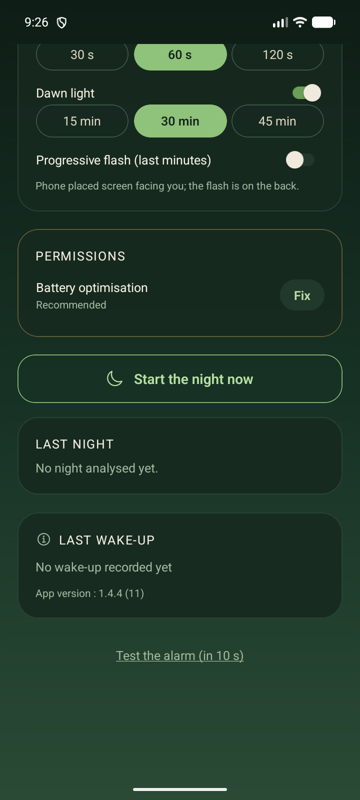
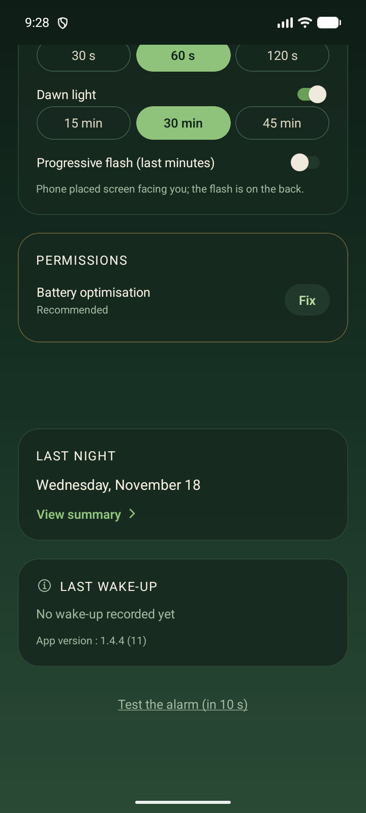
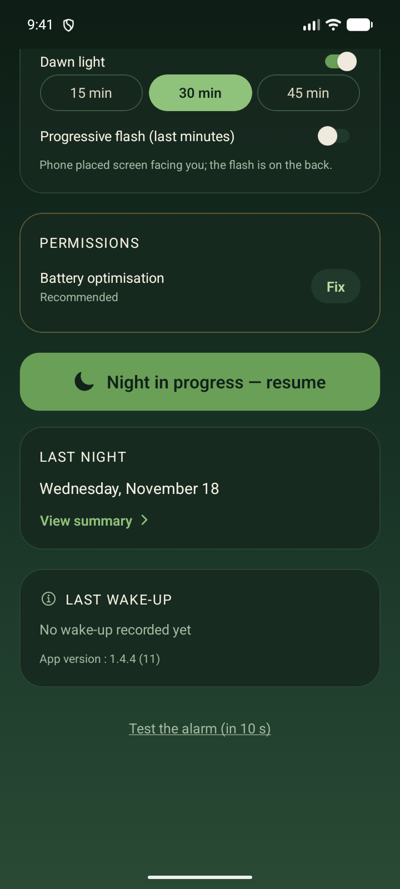
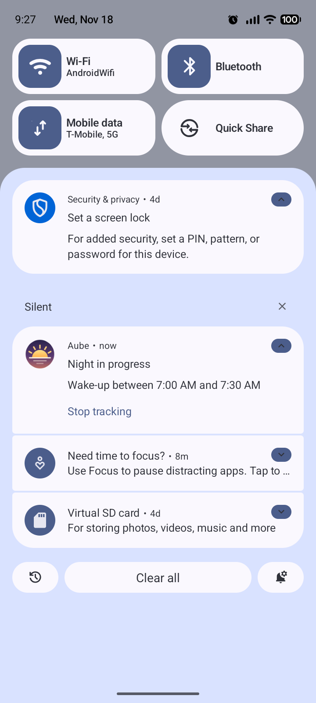
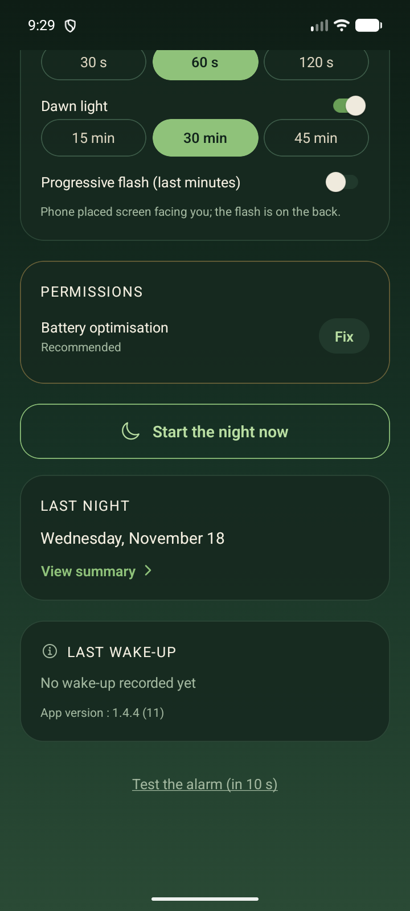
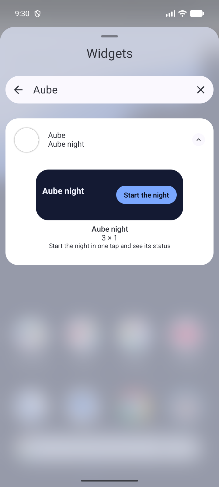
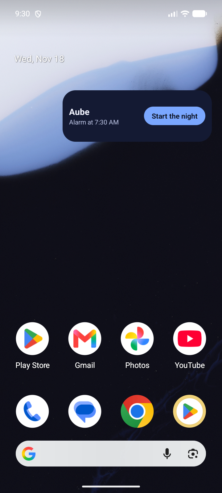
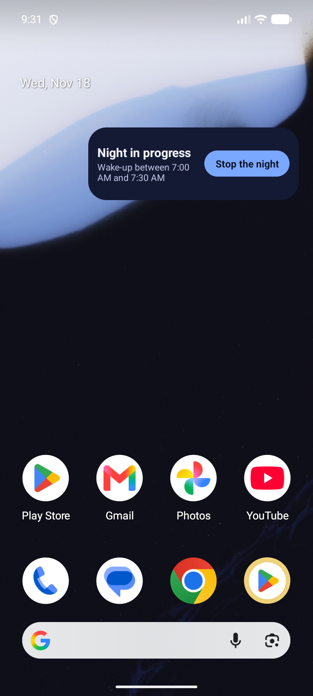

# Rapport : bouton de nuit disparu et widget (18/11/2026)

## Symptôme

Nuit du 17 au 18/11/2026 : sur l'accueil d'Aube, le bouton « Commencer la nuit maintenant » n'apparaissait plus, et aucune statistique n'a été enregistrée pour la nuit.

## Cause

Deux défauts se combinent.

1. Affichage. Quand l'état stocké de la nuit est « tracking », l'accueil remplace « Commencer la nuit maintenant » par le bouton « Reprendre la nuit » (`src/screens/HomeScreen.tsx`). Ce bouton avait `overflow: 'hidden'` avec un `borderRadius` : sous Android, ni le dégradé, ni l'icône, ni le texte n'étaient dessinés. L'accueil montrait un vide entre « Permissions » et « Dernière nuit » : le bouton semblait avoir disparu. Preuve : capture `before-4-home-after-stop.png` (vide), alors que le dump uiautomator contient bien un bouton « Night in progress — resume » aux coordonnées [35,634][685,740] ; après correction, `after-5-resume-visible.png`.

2. État fantôme. L'état « tracking » pouvait rester enregistré sans service de suivi actif : rien n'était mesuré, la détection automatique ne démarrait plus de nuit (elle considère qu'une nuit est déjà en cours), et l'accueil gardait le bouton (invisible) « Reprendre ». Chemin reproduit en 1.4.4 sur émulateur : l'action « Arrêter le suivi » de la notification arrête le service mais laisse l'état « tracking » (`before-3-notification.png` puis `before-4-home-after-stop.png` ; `dumpsys` : plus de `SleepTrackingService`). Autres chemins possibles sans réparation jusqu'ici : démarrage du service de suivi refusé en arrière-plan lors d'une nuit automatique (`NightSession.start` se contente alors d'une notification « touche pour lancer le suivi »), service tué par le système.

Ce qui s'est passé exactement sur le téléphone de Martin n'est pas vérifiable sans ses données : le téléphone n'était pas branché, et l'appli release n'est pas débogable (pas de `run-as`, sauvegarde adb exclue). Les deux défauts suffisent à expliquer les deux symptômes.

## Données de la nuit

Non récupérables depuis le PC. Si le service de suivi ne tournait pas, aucune mesure n'a été écrite. Avec la correction, à la première ouverture de l'appli, une nuit fantôme dépassée de plus de 30 min est close et son fichier finalisé avec ce qui a pu être mesuré, pour qu'elle apparaisse dans Stats ; une nuit sans aucune mesure restera vide.

## Corrections

- `5a7d2ad` fix(night) : l'action « Arrêter le suivi » de la notification termine la nuit comme l'appli (`NightSession.cancel`). Nouvelle règle `AlarmPolicy.trackingRepair`, appliquée par `NightSession.repair` à l'ouverture de l'appli (`getStatus`), au réarmement, à chaque sonde automatique, au démarrage et après mise à jour : service mort avant l'heure cible → relancé ; heure cible dépassée de plus de 30 min → nuit close ; juste dépassée → l'alarme de secours sonne (après redémarrage : sonnerie tardive). `getStatus` expose aussi `trackingAlive`.
- `dde7ea5` fix(home) : bouton principal de l'accueil en fond plein sans `overflow: 'hidden'` ; « Reprendre la nuit » est visible pendant une nuit.

## Widget

- `d1306bb` feat(widget) : widget d'écran d'accueil 3x1 « Nuit Aube ». Au repos : « Aube », « Réveil à HH:MM » et un bouton « Commencer la nuit », qui lance la nuit sans ouvrir l'appli avec l'heure de réveil et la fenêtre réglées dans l'appli (comme « Commencer la nuit maintenant », sans tenir compte des jours). Pendant la nuit : « Nuit en cours », la fenêtre de réveil et un bouton « Arrêter la nuit ». Toucher le texte ouvre l'appli. Les actions passent par un récepteur non exporté. Le widget se met à jour à chaque changement d'état de la nuit et des réglages.
- Captures (émulateur en anglais) : `widget-0-picker.png`, `widget-1-idle.png`, `widget-2-tracking.png` (service de suivi actif vérifié par `dumpsys`), `widget-3-stopped.png`.
- Ajout : appui long sur l'écran d'accueil, Widgets, Aube.

## Preuves

- Test rouge puis vert : `GhostNightTest.notificationStopEndsTheNight` échouait avant la correction (« the stop action must end the night (NightSession.cancel), not only stop the service »).
- Tests Kotlin : 94 pass (dont 13 nouveaux : `GhostNightTest` 6, `NightWidgetModelTest` 5, `NightWidgetManifestTest` 2). Jest : 139 pass. Build debug et release : réussis. Pas d'erreur tsc dans les fichiers touchés.
- Essai sur émulateur Pixel 8 : avant (APK publiée v1.4.4) et après (build release locale, signée avec la clé de debug).

## Limites

- Pas encore essayé sur le téléphone de Martin.
- La version reste 1.4.4 (11) : une release demanderait de passer en 1.4.5.
- Le bouton principal de l'accueil perd son dégradé (fond plein).
